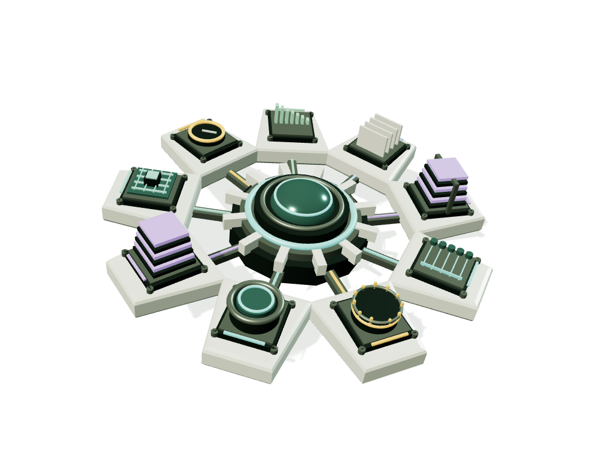

# 2026 August Collection｜2026_8月合輯

## AI & Engineering Practice Portfolio｜AI 與工程實務作品集

An interactive, scroll-driven portfolio that turns nine AI, data, and engineering projects into continuously operating 3D scenes. Visitors can follow an automated guided tour or explore manually, change each scenario, observe how the model and monitoring panel react, and trace the evidence and limitations behind every result.

這是一套以「讓完全外行的人也能看懂」為目標製作的互動作品集。九個 AI、資料與工程專案不只用文字陳列，而是各自轉化成持續運作的 3D 工作場景：例如鋼板通過視覺檢測線、機械臂遇到安全事件後停止、資料經品質閘門分流、模型版本通過或被發布規則阻擋。使用者可選擇自動導覽或手動遊覽，透過滾動、滑鼠與情境按鈕觀察「輸入發生什麼變化、系統如何判斷、結果如何呈現，以及哪些事情仍需要人工確認」。

> This repository is a demonstrable portfolio experience, not a production control system. It uses local assets, synthetic teaching scenarios, and documented source snapshots; it does not operate factory equipment, execute financial trades, or train and publish models from the browser.
>
> 本倉庫是可操作的作品展示，不是正式生產控制系統。網頁使用本機素材、合成教學情境與已記錄的來源快照，不會控制工廠設備、執行金融交易，也不會在瀏覽器內訓練或發布模型。

## What the nine projects demonstrate｜九項作品在做什麼

| # | Project｜作品 | Practical purpose｜實務用途 | Interactive demonstration｜互動展示 |
| --- | --- | --- | --- |
| 01 | **Surface AOI Inspector｜視覺瑕疵檢測** | Inspect a moving workpiece and distinguish normal, scratched, and review-needed states.｜檢查移動中的工件，區分正常、刮痕與需人工複核狀態。 | A conveyor, inspection unit, workpiece, and monitor share one state; changing the defect changes both the 3D scene and result panel.｜輸送帶、檢測機、工件與畫面共用同一狀態，切換瑕疵時同步改變。 |
| 02 | **RTSafe Sensor Hub｜即時安全監督** | Explain how sensor thresholds and heartbeat loss lead to a safe stop.｜說明感測門檻與心跳遺失如何觸發安全停止。 | The robotic arm keeps moving normally, then stops and preserves the cause when force is exceeded or heartbeat is lost.｜正常時機械臂持續運作；力量超限或心跳遺失後停止並保留原因。 |
| 03 | **Retail Data Hub｜資料整理與對帳** | Validate, quarantine, deduplicate, and reconcile a data batch before publication.｜在資料發布前完成驗證、隔離、去重與金額對帳。 | A fixed synthetic batch flows through quality gates; users can inject an amount mismatch or replay the same batch.｜合成批次流經品質閘門，可注入金額差異或重跑同一批資料。 |
| 04 | **KnowledgeOps Studio｜AI 知識與品質管理** | Demonstrate permission checks, retrieval, citation validation, and human escalation.｜展示權限檢查、檢索、引用驗證與人工分流。 | Answers are delivered only when access and evidence pass; weak evidence or denied access stops the flow.｜只有權限與證據通過才交付回答，否則停止並轉人工。 |
| 05 | **OpsFlow Agent｜營運事件調查** | Assemble read-only telemetry, maintenance history, and SOP evidence for incident review.｜整合唯讀遙測、維護紀錄與 SOP 證據，支援事件調查。 | Complete evidence produces a summary; high-risk or repeatedly failed cases are handed to a person without external action.｜證據完整時產生摘要；高風險或多次失敗時轉人工，且不執行外部動作。 |
| 06 | **Demand Planning Workbench｜需求預測與情境規劃** | Compare a seven-day baseline with adjustable planning assumptions.｜比較七日基準與可調整的規劃假設。 | The 3D bars and chart share the same data while users apply +25% and -20% scenarios.｜立體柱與圖表共用同一數列，可切換上調 25% 與下調 20% 情境。 |
| 07 | **OpenFund Risk Workbench｜持倉分析與風險觀測** | Show concentration risk and the effect of incomplete holdings data without giving investment advice.｜呈現集中度風險與資料缺漏的影響，不提供投資建議。 | Equal, concentrated, and incomplete synthetic holdings alter the ring chart and quality gate; missing values are not invented.｜均分、集中與缺漏的合成持倉會改變環形圖與品質閘門，缺值不補造。 |
| 08 | **SimOps Studio｜電路模擬與流程自動化** | Explain pass/fail thresholds, worker timeouts, and bounded retry behavior in a simulation workflow.｜說明模擬流程中的通過門檻、工作節點逾時與有限重試。 | Fixed teaching curves are compared with a 50 mΩ threshold; timeout scenarios stop after two illustrated attempts.｜固定教學曲線與 50 mΩ 門檻比較；逾時最多示意兩次嘗試後停止。 |
| 09 | **ModelForge-TW｜模型微調、量化與發布治理** | Compare NF4, Q8, and Q4 artifacts under evaluation and release policies.｜依評測與發布規則比較 NF4、Q8 與 Q4 產物。 | The compute rack, rotating weight core, metrics, and release exits react together when a version is published, retained as fallback, or blocked.｜切換已發布、回復備援或阻擋版本時，運算櫃、權重核心、指標與出口同步反應。 |

## Experience design｜體驗設計

- **Automatic guided tour｜自動導覽模式**：逐站播放字幕式情境說明，自動操作 27 個情境按鈕，並以較慢的彩色粒子分解／重組動畫連接九座場景。
- **Manual exploration｜手動遊覽模式**：保留自由滾動、章節定位、滑鼠視差、監看放大、暫停與情境切換，讓使用者自行比較結果。
- **Responsive and accessible behavior｜響應式與動態偏好**：桌面與手機採不同構圖；支援 `prefers-reduced-motion`，JavaScript 關閉時仍保留可閱讀的靜態內容。
- **Evidence-aware presentation｜證據導向呈現**：作品頁保留來源、測試條件、限制與未驗證事項，不把合成資料或固定腳本描述成線上模型的即時成果。

## Latest interactive build｜新版工程場景 9／9（2026-09-23）

開發預覽預設進入 `experience.html`：AOI 動態輸送線、RTSafe 安全控制站、Retail 資料對帳站、KnowledgeOps 知識治理台、OpsFlow 事件調查台、Demand Planning 需求規劃台、OpenFund 持倉觀測台、SimOps 電路模擬台、ModelForge 模型治理台與八段可逆彩色粒子轉場。目前完成 **9／9 座獨立 3D 場景**；九站均可直接導覽與操作。提供暫停、放大監看、情境切換、手機排版與減少動態模式。

第九站從「09 模型治理」或 `#forge` 進入：運算櫃、旋轉權重核心與三個版本出口。切換 NF4 已發布、Q8 回復備援、Q4 阻擋，模型與監看同步。數字引用 policy-v2 來源實測快照，非網頁新評測；不執行訓練、推論或發布。最前方新增雙模式布幕；自動導覽會逐站解說並操作 27 個情境，手動遊覽則保留自由捲動。96 項自動測試通過，並已實際操作導覽、慢速轉場及桌面／手機尺寸。設計與驗證見 [雙模式自動導覽](docs/AUTOPLAY-TOUR.md)。

本輪 96 項 Node 測試通過，已操作檢查桌面與手機尺寸。合成資料、測試範圍與未驗證項目見 [製作與驗證紀錄](docs/IMMERSIVE-SCENES.md)。Windows 一鍵 EXE 已於 2026-09-30 重新封裝為 launcher 1.2.0，預設進入 `experience.html`；先前的傳送 ZIP 尚未重包。以下圖片為舊版主體。



## Windows standalone launcher｜Windows 雙擊即開

使用建置產物 `2026_8月合輯.exe`，雙擊自動開啟預設瀏覽器。**不需 Node.js、不必解壓素材、不需連網載入模型。** 結束時使用右下角 AXIS-09 圖示 →「結束 AXIS-09」。

需要 Windows 10／11、.NET Framework 4.x 與現代瀏覽器。3D 動画需 WebGL 2；減少動態開啟時顯示靜態版本。EXE 尚未簽章，不放進 Git 歷史。詳見 [桌面版說明](desktop/README.md)。

## Local development｜本機開發預覽

安裝 Node.js 22+，在原始碼資料夾執行 `npm start`，開啟 http://127.0.0.1:4173/ 。網站執行不需安裝 npm 套件。也可使用 Start-Showcase.cmd（需要 PATH 中已有 Node.js）。

- experience.html：新版九場景 3D 展示（預設入口）。
- showcase.html：保留九模組舊版滾動展示，品牌連結可返回新版。
- storyboard.html：分鏡、模組素材與歷史驗證畫面。
- index.html：保留原有八模組工作台 v5.0.0。
- docs/showcase-evidence.md：來源、限制與模型比較。
- output/pdf/：既有八模組手冊，不是九模組新版測試報告。

## Verification and Windows build｜測試與 Windows 建置

建置使用 PowerShell 7（pwsh），並遵循電腦既有的指令碼執行原則；EXE 使用者不需 PowerShell。

```powershell
npm test
pwsh -File tools/build-windows.ps1
pwsh -File tools/test-windows.ps1
```

產物位於 dist：EXE、SHA256SUMS.txt、launcher-test-results.json。測試前先從系統匣結束正在使用的 AXIS-09。

96 項 Node 測試涵蓋工作台／核心指紋、場景狀態、雙模式導覽、Retail 對帳、KnowledgeOps／OpsFlow 腳本、Demand Planning／OpenFund／SimOps 情境、ModelForge 來源快照、頁首層級與內容契約檢查。20 項 Windows 檢查已對 launcher 1.2.0 重新執行，包含最新版首頁、紅色導覽呼吸燈資源、3D 素材、唯讀安全限制、單一執行個體與備用連接埠。歷史瀏覽器驗證及窄視窗修正見 [版本記錄](docs/SCROLL-EDITION.md)、[滾動修正](docs/SCROLL-HOTFIX.md)。HTTP 測試不能替代視覺驗證。

選用的素材重製／瀏覽器驗證工具需要 `npm install --no-save playwright@1.62.1`、Microsoft Edge 及執行中的開發伺服器；並非使用網站或建置 EXE 的必要依賴。手冊重製另需 Python、reportlab 及 Windows 微軟正黑體。

## Architecture and customization｜架構與客製化

| 檔案 | 負責內容 |
| --- | --- |
| experience.html / experience.css | 新場景的內容、監看與響應式構圖 |
| experience.js / experience-state.js | 場景操作、滾動協調及模擬狀態 |
| experience-models.js | 九座獨立場景的幾何、運動及表面粒子 |
| showcase-data.js | 作品、來源、模型與情境 |
| showcase.js / showcase.css | 滾動、面板、鼠標、排版、動態偏好 |
| axis-model.js / axis-renderer.js | 3D 幾何、姿態、相機與降級 |
| desktop/Launcher.cs | 單檔啟動器、唯讀本機 HTTP |
| tools/build-windows.ps1 | 內嵌資源清單及编譯 |

本作品展示合成情境與已有來源，不等同部署完整 LLM 訓練平台，不含模型權重、GPU 推論服務或雲端帳號憑證。

## Public repository and licensing｜公開倉庫與授權

Public source repository｜公開原始碼：<https://github.com/bdf10019/2026-8-ai-engineering-portfolio>

The included GitHub Actions workflow runs the Node test suite, builds the standalone Windows executable, verifies the launcher, and uploads a 30-day workflow artifact. It does not automatically create a GitHub Release or deploy the website. See the [publishing guide](docs/GITHUB-PUBLISH.md) for details.

已附 GitHub Actions Windows 自動建置流程：執行 Node 測試後建置單檔 EXE、驗證啟動器，並保留 30 天的 Actions artifact；流程不會自動建立 GitHub Release 或部署網站。詳見 [發布指南](docs/GITHUB-PUBLISH.md)。

No repository-wide open-source license has been granted. Public visibility allows the source to be viewed, but does not automatically grant permission to copy, modify, or redistribute it. Three.js retains its own license in [Third-Party Notices](THIRD-PARTY-NOTICES.md).

本倉庫尚未授予整體開源授權。公開可見代表任何人可以閱讀原始碼，但不等於自動取得複製、修改或再散布權。Three.js 的原授權保留於 [第三方通知](THIRD-PARTY-NOTICES.md)。
