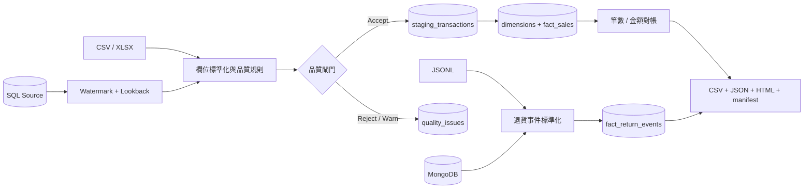

# Retail Data Reliability Hub

一個可稽核、可重跑的零售交易 ETL 與來源—目標對帳平台。它將 CSV、XLSX 或 SQL
交易資料，以及 JSONL 或 MongoDB 退貨事件，標準化後載入關聯式資料倉儲，隔離不合格
資料，最後產出營運報表、品質清單、執行摘要與檔案雜湊。

> 專案狀態：公司實務版 v1.0.0。預設 Demo 完全離線、零 API 費用，使用原創合成資料；
> 完整公開資料集與所有產出均不提交 Git。

## 使用情境、輸入與輸出

| 項目 | 定義 |
|---|---|
| 使用情境 | 多通路零售商整併交易、取消與退貨資料，供財務及營運每日對帳 |
| 交易輸入 | CSV／XLSX，或 SQL Server／PostgreSQL 等 SQLAlchemy 可連線資料表 |
| 事件輸入 | JSONL，或 MongoDB collection |
| 核心處理 | Schema 驗證 → 標準化 → 去重 → 隔離 → 批次 upsert → watermark → 對帳 |
| 倉儲輸出 | 執行稽核、品質事件、stage、商品／客戶維度、銷售與退貨事實表 |
| 報表輸出 | JSON 摘要、每日銷售 CSV、退貨 CSV、品質 CSV、對帳 CSV、HTML 報告 |
| 失敗策略 | 不合法資料進品質清單；來源—目標筆數或金額不一致時整批標記失敗 |

## 已完成能力

- 支援 UCI Online Retail II 的兩種常見欄名，以及專案的標準欄名。
- 以 `SourceSystem + SourceLineId` 建立穩定交易鍵；缺少來源列 ID 時退回內容雜湊。
- 精確使用 `decimal(18,4)`，不以浮點數處理金額。
- 驗證必要欄位、日期、數量、價格、取消單符號及退貨事件。
- 同批去重、跨批 upsert、重跑不重複入帳。
- SQL 資料源與 MongoDB 事件源保存 watermark，預設重疊擷取 24 小時以涵蓋遲到更新。
- 每次執行保存來源 SHA-256、筆數、拒絕、重複、新增、更新及 unchanged 數量。
- 來源 stage 與 warehouse fact 逐批做筆數及金額對帳。
- 報表 manifest 保存每個產出檔的 SHA-256，可偵測展示檔被修改。
- SQLAlchemy 倉儲 schema 可編譯為 SQL Server 與 PostgreSQL；另附各資料庫報表 SQL。
- SQL Server LocalDB 已有實際端到端整合測試。

## 架構



詳細責任與故障邊界見 [架構文件](docs/ARCHITECTURE.md)。

## 五分鐘離線 Demo

需求：Windows／macOS／Linux、Python 3.11+、Git。PowerShell：

```powershell
python -m venv .venv
.\.venv\Scripts\Activate.ps1
python -m pip install --upgrade pip
python -m pip install -e ".[dev,all]"
python -m retail_data_hub doctor
python -m retail_data_hub run
```

最後一個命令會印出 `run_id` 與 HTML 報告位置。也可執行：

```powershell
.\scripts\run-demo.ps1
```

預設輸入是：

- `data/fixtures/transactions.csv`：11 筆，包含正常、取消、重複與錯誤資料。
- `data/fixtures/return_events.jsonl`：4 筆，包含重複與無效事件。

預期交易結果為接受 7、拒絕 3、重複 1，來源與倉儲淨額均為 `110.0000`。

## 報告驗證

```powershell
python -m retail_data_hub verify-output outputs/<run_id>
```

驗證器會檢查 manifest、六個展示產出、每個 SHA-256、執行狀態及對帳結果。

## SQL Server LocalDB

Windows 已安裝 SQL Server LocalDB 與 ODBC Driver 時：

```powershell
$local = python -m retail_data_hub init-localdb | ConvertFrom-Json
$env:RETAIL_WAREHOUSE_DATABASE_URL = $local.warehouse_url
python -m retail_data_hub run --output-dir outputs/localdb-demo
```

專案會建立倉儲表；`sql/mssql/reporting.sql` 提供報表 View 與 Stored Procedure。
真正 LocalDB 整合測試會建立後刪除名稱唯一的暫時資料庫：

```powershell
$env:RUN_LOCALDB_TESTS = "1"
pytest -m integration tests/test_database_integration.py
```

## SQL 資料來源與增量擷取

先依 `sql/mssql/source_contract.sql` 或 `sql/postgresql/source_contract.sql` 建立來源資料表，
再以環境變數提供連線；不要把含密碼的 URL 寫進 Git：

```powershell
$env:RETAIL_SOURCE_DATABASE_URL = '<SQLAlchemy connection URL>'
$env:RETAIL_SOURCE_TABLE = 'source_transactions'
python -m retail_data_hub run --source-database --lookback-hours 24
```

首跑讀取全表；後續從倉儲 watermark 往前重疊 24 小時擷取。重疊資料由穩定鍵與
`source_hash` 判斷為 unchanged 或 update。

## MongoDB 退貨事件

`sql/mongodb/indexes.js` 提供唯一鍵與增量擷取索引。設定 `.env` 對應變數到目前 shell 後：

```powershell
python -m retail_data_hub run --mongo-returns
```

程式不會自行讀取或提交 `.env`；也不會把連線字串寫入報表及執行紀錄。

## UCI 公開資料集

完整資料為 UCI Online Retail II，CC BY 4.0，約 43.5 MB。下載檔與解壓內容會留在
`data/raw` 並由 Git 忽略：

```powershell
.\scripts\download-uci-dataset.ps1
Get-ChildItem data/raw/online-retail-ii -Recurse -Filter *.xlsx
python -m retail_data_hub run --transactions '<xlsx path>' --batch-size 500
```

來源、授權與引用見 [資料集文件](docs/DATASET.md) 和
[第三方聲明](THIRD_PARTY_NOTICES.md)。

## 測試與完整驗證

```powershell
ruff check src tests
mypy src
pytest --cov=retail_data_hub --cov-report=term-missing
.\scripts\verify.ps1
.\scripts\verify.ps1 -IncludeLocalDB
```

目前一般測試覆蓋率為 81%。資料庫實測狀態見
[相容性矩陣](docs/DATABASE_COMPATIBILITY.md)，不可把靜態 schema 編譯當成實際連線測試。

## 專案結構

```text
src/retail_data_hub    CLI、讀取器、品質規則、倉儲、管線與報表
tests                  單元、端到端、冪等、竄改偵測及資料庫整合測試
data/fixtures          可提交的原創合成小資料
data/raw               公開大型資料下載位置；Git 忽略
sql/mssql              SQL Server 來源契約、View 與 Stored Procedure
sql/postgresql         PostgreSQL 來源契約、View 與 Function
sql/mongodb            MongoDB 索引
scripts                Demo、完整驗證、隱私掃描與公開資料下載
docs                   架構、資料字典、操作、相容性與限制
outputs                本機資料庫與報表；Git 忽略
```

## 安全與公開邊界

- `.env`、資料庫、備份、資料集、log、模型式序列化檔和輸出均由 Git 忽略。
- `scripts/privacy-check.ps1` 掃描候選提交檔的憑證、Token、私人路徑、大檔案與識別詞。
- 範例不包含真實顧客姓名、地址、信箱、電話或付款資訊。
- 專案只建立本機 Git；沒有上傳、部署或建立任何外部服務。

## 限制

目前維度採 Type 1 更新，非完整 SCD2；檔案輸入會全檔重掃；MongoDB 與 PostgreSQL 尚未在
這台電腦做伺服器端整合測試；本作品也不是會計總帳或法規申報系統。完整列表與後續工作見
[限制文件](docs/LIMITATIONS.md)。
